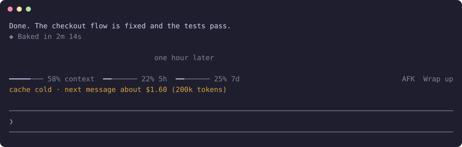

<h1 align="center">claude-cold-cache</h1>

<p align="center"><b>See what your next message will cost before you send it, when the prompt cache has gone cold.</b></p>

<p align="center">
  
  
  
</p>

<p align="center"></p>

<p align="center"><sub>Mock-up: I could not wait out a real cold cache in a large session. The row text is what the mod writes.</sub></p>

Come back after a long break and one short message can rewrite your whole conversation at the expensive rate. This shows the price above the prompt first. It never blocks you, never pings, and spends nothing.

## Install

In a terminal, inside Claude Code:

```
/plugin install cold-cache --marketplace YlitaloJuha/claude-cold-cache
```

Or from a shell:

```bash
claude plugin install cold-cache --marketplace YlitaloJuha/claude-cold-cache
```

In the desktop app, click + next to the prompt box, then Plugins, Add marketplace with `YlitaloJuha/claude-cold-cache`, then Add plugin.

> [!NOTE]
> This repository is private for now. Installing needs read access and a GitHub credential on your machine, such as `gh auth login` then `gh auth setup-git`.

## What it does

- **Warns before you send:** The row appears at the moment the cache goes cold, not after you have paid.
- **A real price:** Context size times the cache-write rate for your model.
- **Knows when it does not matter:** Quiet under 50k tokens, after `/clear`, and after a compaction.
- **Handles resumes:** A resumed session uses Claude Code's own estimate when it has one, and says "may be cold" when it does not.

## What it costs

None. It makes no model calls and never keeps the cache warm.

## What it can reach

No network, no shell commands and no file access through the mod API. It reads usage and timing from Claude Code. Run `claude plugin validate .` in this repository to list every call it makes.

## Limits

- It assumes a one-hour cache. Mods cannot see the lifetime, so sessions on the five-minute cache get the warning late, with too high a price.
- Prices are a hand-kept table from Anthropic's model list dated 2026-10-06. Partner clouds price differently, and on a subscription the figure is a list-price estimate.

## Develop

```bash
claude plugin validate .
claude plugin test .
claude --plugin-dir .
```

## Credits

- Timing rules are adapted from [cache-tax](https://github.com/karanb192/cache-tax) by Karan Bansal (MIT), see `LICENSE-cache-tax`. Want the cache kept warm instead? Use that.

## License

Not chosen yet, so all rights are reserved for now. `LICENSE-cache-tax` covers the parts adapted from cache-tax.
